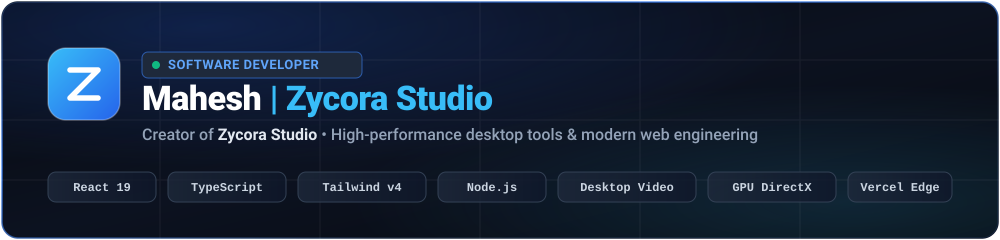

  

  
  
  
  

 

> **Software Developer & Creator of [Zycora](https://zycora-studio.vercel.app)**  
> Focused on building ultra-responsive desktop applications, performance-driven web interfaces, and modern developer tooling.

---

### 🚀 What I'm Working On

- 🖥️ **[Zycora](https://zycora-studio.vercel.app)** — Lead creator of a next-generation desktop video editing application engineered for fast multi-format timeline workflows (16:9 widescreen to 9:16 vertical reels).
- 📱 **Mobile & Cross-Platform** — Architecting native Android and iOS client sync for mobile video creation.
- ⚡ **Performance Engineering** — GPU-accelerated video rendering, low-latency playback scrubbing, and offline-first software design.
- 🌐 **Web Architecture** — Full-stack web development with React, Vite, Tailwind CSS, and global edge deployments on Vercel.

---

### 🛠️ Tech Stack & Skills

  

| Domain | Technologies & Frameworks |
| :--- | :--- |
| **Languages** | JavaScript (ES6+), TypeScript, Python, HTML5, CSS3 |
| **Frontend** | React 19, Vite, Tailwind CSS v4, Lucide Icons |
| **Backend & APIs** | Node.js, Express, REST APIs, WebSockets |
| **Desktop & Hardware** | Native Desktop Architecture, DirectX / OpenGL GPU Acceleration |
| **DevOps & Cloud** | Git, GitHub Actions, Vercel Edge Network, CDN Distribution |

---

### 📌 Featured Repositories

- 🎬 **[Zycora](https://zycora-studio.vercel.app)** — The lightning-fast desktop video editor. 100% watermark-free, offline privacy, and multi-track editing. Windows official release live, Android & iOS editions upcoming.

---

### 📊 GitHub Activity & Metrics

  

  
  

 

#### ⚡ Engineering Benchmarks & Architectural Standards

| Metric / Specification | Target & Architecture | Status |
| :--- | :--- | :--- |
| **Playback & Scrub Latency** | `< 16ms` (Sub-frame responsive @ 60 FPS) | 🟢 Optimized |
| **Pipeline Acceleration** | Hardware-accelerated DirectX / OpenGL pipeline | 🟢 Hardware Sync |
| **Memory Efficiency** | Sub-200MB baseline idle memory footprint | 🟢 Optimized |
| **Local Privacy Guarantee** | 100% On-Device local processing, zero telemetry leaks | 🔒 Verified Local |
| **Cloud Edge Deployment** | Global Vercel Edge CDN distribution & DNS routing | 🟢 99.9% Availability |
| **Release Stability** | Automated CI/CD build tests passing | 🟢 Passing |

---

### 💬 Connect & Community

- 🌐 **Website:** [zycora-studio.vercel.app](https://zycora-studio.vercel.app)
- 🎮 **Discord Community:** [Zycora Creator Hub](https://discord.gg/TGyxE3T4Hy)
- ✉️ **Contact:** [mahesh160708ti@gmail.com](mailto:mahesh160708ti@gmail.com)
